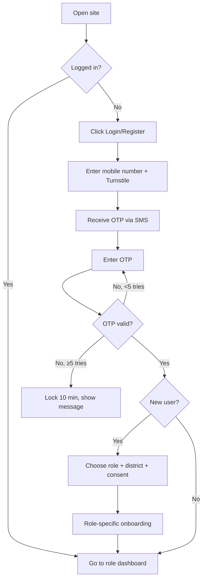
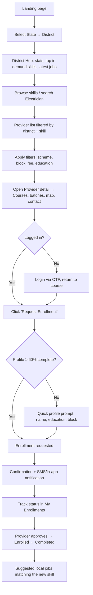
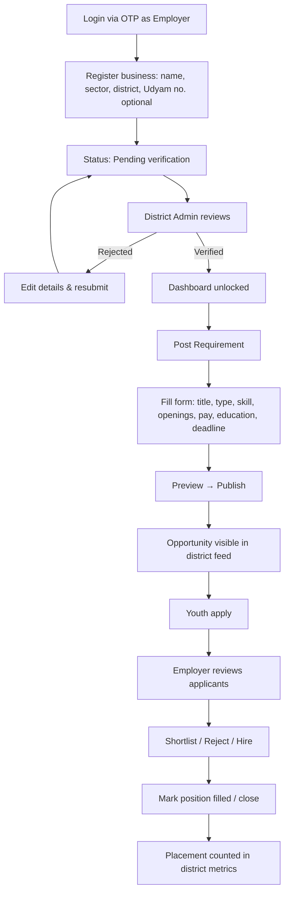
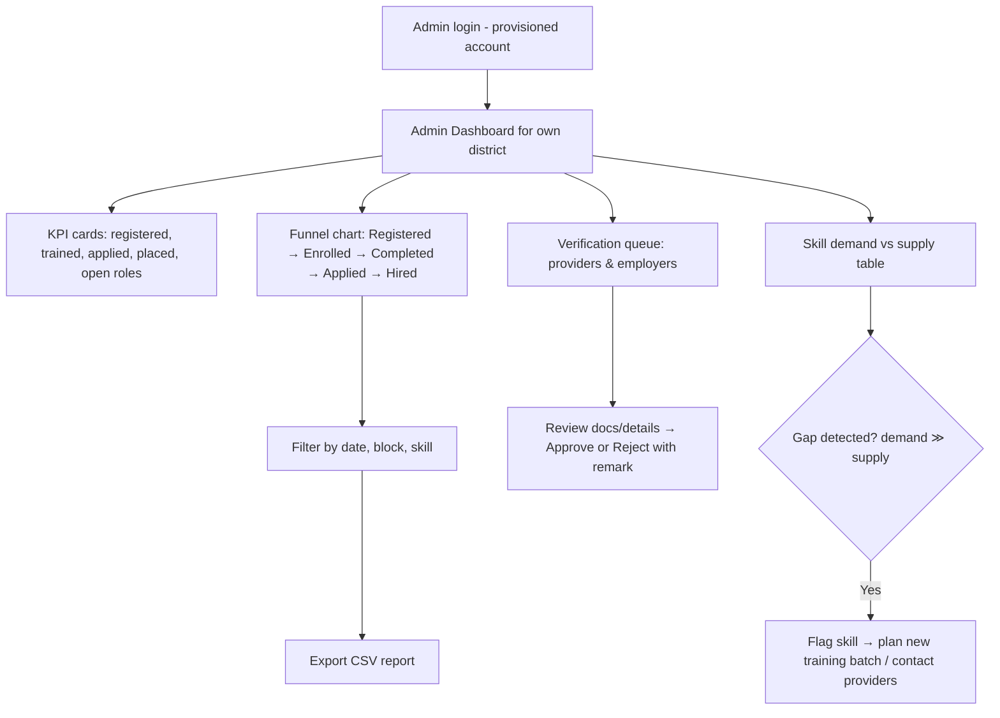
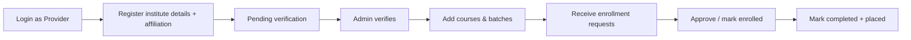

# App Flow: User Journeys & Workflows

## Ek Zila – Ek Yuva Kaushal Network

---

## 0. Global Navigation & Route Map

| Area | Routes (React Router) | Access |
|------|----------------------|--------|
| Public | `/` (landing + district picker), `/d/:slug` (District Hub), `/providers`, `/providers/:id`, `/jobs`, `/jobs/:id` | Everyone |
| Auth | `/login`, `/verify-otp`, `/onboarding` | Guests |
| Youth | `/me`, `/me/skills`, `/me/enrollments`, `/me/applications` | `youth` |
| Provider | `/provider/dashboard`, `/provider/courses`, `/provider/enrollments` | `provider` |
| Employer | `/employer/dashboard`, `/employer/post`, `/employer/jobs/:id/applicants` | `employer` |
| Admin | `/admin/:districtSlug`, `/admin/:districtSlug/verifications`, `/admin/:districtSlug/gap` | `district_admin`, `super_admin` |

**Global UX rules**
- Language toggle (हिन्दी / English) in the header; default Hindi.
- Selected district persists (localStorage + profile) and prefilters all lists.
- Browsing is public; login is required only at the *action* moment (Enroll / Apply / Post).
- Every list has loading skeletons, empty states, and retry on error.

---

## 1. Common Flow: Registration & Login (all roles)

**Steps**
1. User enters a 10-digit mobile number; Cloudflare Turnstile runs invisibly.
2. API checks Redis rate limits (3 OTPs/10 min per phone) and sends OTP (valid 5 min).
3. User enters the 6-digit OTP (resend after 60 s).
4. On success: tokens issued, session saved in Redis.
5. New users: choose role, confirm district, accept privacy consent (required).
6. Redirect to the correct dashboard.

**Edge cases:** wrong number → "change number" link; expired OTP → resend; rate limited → countdown timer; slow network → retry button with preserved input.

---

## 2. Flow A – Student Selects District & Finds Local Skill Training

**Actor:** Youth/Student | **Goal:** Find a relevant, nearby, verified course and request enrollment.

### Step-by-step

| # | Student action | System behaviour | API / Cache |
|---|----------------|------------------|-------------|
| 1 | Opens site; picks state and district (search box with Hindi/English names). | Stores `district_id`; navigates to `/d/:slug`. | `GET /districts` (Redis `cache:districts:{state}`) |
| 2 | Sees District Hub: registered youth, open roles, top 10 in-demand skills, upcoming batches. | Renders cached stats. | `GET /districts/{id}/stats`, `/skills/demand` (Redis hash / zset) |
| 3 | Taps a skill chip (e.g., "Electrician") or searches. | Skill tree lookup, typeahead. | `GET /skills/categories` (cached 24 h) |
| 4 | Views providers list with verified badges, distance/block, fee, seats. | Paginated, filtered results. | `GET /providers?district_id&skill_id` (versioned cache) |
| 5 | Opens provider detail: courses, duration, certification, next batch, call/map buttons. | Fetches provider + courses. | `GET /providers/{id}` |
| 6 | Taps **Request Enrollment**. | If guest → login (returns to same page). Eligibility check (min education, seats). | `POST /courses/{id}/enroll` |
| 7 | Sees confirmation and status "Requested". | Notification to provider; `ver:district` bumped; stats invalidated. | Redis `INCR`, `DEL` |
| 8 | Tracks progress in **My Enrollments**; gets updates. | Status updates by provider. | `GET /users/me/enrollments` |
| 9 | After completion, sees "Jobs for your skill in your district". | Match by skill + district. | `GET /opportunities?district_id&skill_id` |

**Alternate/Error paths**
- No providers for a skill → show nearest districts' providers and a "Notify me" option.
- Course full → offer waitlist / similar courses.
- Not eligible (education) → show eligibility reason + other courses.
- Offline → cached district data from PWA; actions queued/blocked with message.

**Success criteria:** District chosen in <30 s; enrollment request in ≤ 5 taps after finding the course.

---

## 3. Flow B – Industry/MSME Posts Local Job/Apprenticeship Requirements

**Actor:** Employer (MSME owner/HR) | **Goal:** Get verified and publish a requirement to local youth.

### Step-by-step

| # | Employer action | System behaviour | API / Cache |
|---|-----------------|------------------|-------------|
| 1 | Logs in with OTP and selects role *Employer*. | Creates user with role. | `POST /auth/otp/verify` |
| 2 | Completes business profile (name, sector, address, district, optional Udyam number). | Creates `employers` row with `pending` status. | `POST /employers` |
| 3 | Waits for verification (sees status banner; can draft postings). | Appears in District Admin queue; SMS on decision. | `GET /admin/verifications` (admin side) |
| 4 | After verified, clicks **Post Requirement**. | Form with skill picker (same taxonomy as training). | `GET /skills/categories` |
| 5 | Enters title, type (job/apprenticeship/internship/gig), openings, pay range, min education, location, deadline. | Client + server validation (pay range, deadline in future). | `POST /opportunities` |
| 6 | Previews and publishes. | Row created `open`; `INCR ver:district:{id}`, `ZINCRBY skill_demand`, `DEL stats`. | Redis writes |
| 7 | Opens **Applicants** for a posting. | Lists applicant profiles (skills, education, training completed). | `GET /opportunities/{id}/applications` |
| 8 | Shortlists/rejects/hire. | Status updates; applicant notified. | `PATCH /applications/{id}` |
| 9 | Marks posting `filled` or `closed`. | `ZINCRBY -1` demand; placement count increments. | `PATCH /opportunities/{id}` |

**Alternate/Error paths**
- Unverified employer tries to post → blocked with "Pending verification" and ETA.
- Duplicate posting detected (same title/skill within 7 days) → warning.
- Posting expires on deadline → auto status `expired` (nightly job) + option to renew.
- Applicant details are visible only for that employer's own postings.

**Success criteria:** Verified employer publishes a posting in < 3 minutes.

---

## 4. Flow C – District Admin Monitors Skill-to-Employment Metrics

**Actor:** District Admin (DSDO/DIC officer) | **Goal:** Track outcomes, spot skill gaps, verify participants.

### Step-by-step

| # | Admin action | System behaviour | API / Cache |
|---|--------------|------------------|-------------|
| 1 | Logs in (account provisioned by Super Admin; OTP + optional 2nd factor). | Session scoped to `district_id`. | Auth APIs |
| 2 | Lands on dashboard; sees KPI cards for current month. | Reads cached aggregates (5 min). | `GET /admin/districts/{id}/funnel` (Redis cache) |
| 3 | Adjusts filters: date range, block, skill. | New cache key per filter set. | Same endpoint with params |
| 4 | Opens **Skill Gap** view: demand (open roles) vs supply (trained youth) per skill. | Computed from zsets/SQL; highlights gaps in red. | `GET /admin/districts/{id}/gap` |
| 5 | Opens **Verification Queue**; reviews pending providers/employers. | Shows submitted details, location, documents (if any). | `GET /admin/verifications` |
| 6 | Approves/rejects with remark. | Updates status, writes `audit_logs`, notifies applicant, bumps cache version. | `POST /admin/verifications/{type}/{id}` |
| 7 | Drills into a provider's placement outcomes. | Aggregates enrollments → hires. | `GET /providers/{id}` (admin view) |
| 8 | Exports CSV report for review meetings. | Streams CSV; action logged. | `GET /admin/districts/{id}/export.csv` |

**Authorization:** District Admin can only access their own district (server-enforced). Super Admin can switch districts.

**Alternate/Error paths**
- No data for selected period → empty state with guidance.
- Large export → async job with download link via notification.
- Suspicious activity (many rejected providers, spam postings) → "Flagged items" widget.

**Success criteria:** Admin answers "How many youth were trained and placed in skill X this month?" in < 3 clicks.

---

## 5. Supplementary Flow: Training Provider Onboarding

Provider updates feed the skill-supply numbers shown to admins and youth.

---

## 6. Notification Matrix

| Event | Recipient | Channel (MVP) |
|-------|-----------|---------------|
| OTP | User | SMS |
| Provider/Employer verified or rejected | Provider/Employer | SMS + in-app |
| Enrollment status change | Youth | In-app (+ SMS optional) |
| New application received | Employer | In-app |
| Application status change | Youth | In-app |
| New opportunity matching skill | Youth (opt-in) | In-app |
| Pending verifications > 3 days | District Admin | Email/in-app |

---

## 7. State Machines

**Enrollment:** `requested → enrolled → completed` ; `requested → rejected` ; `enrolled → dropped`
**Application:** `applied → shortlisted → hired` ; `applied/shortlisted → rejected` ; `applied → withdrawn`
**Opportunity:** `draft → open → closed | filled | expired`
**Provider/Employer:** `pending → verified | rejected` ; `verified → suspended`

---

## 8. Key Screens Checklist (for UI design)

1. Landing + District Picker
2. District Hub
3. Skill Explorer
4. Provider List / Provider Detail
5. Jobs List / Job Detail
6. Login / OTP / Onboarding
7. Youth Profile, Enrollments, Applications
8. Provider Dashboard (courses, requests)
9. Employer Dashboard (post, applicants)
10. Admin Dashboard (KPIs, funnel, gap, verification, export)
