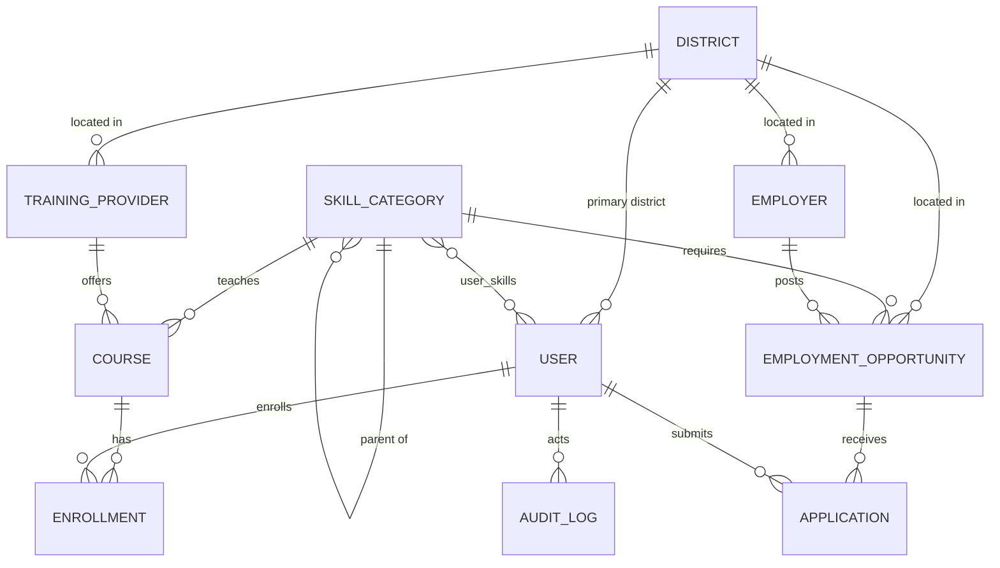

# Backend Schema: Database, API & Redis

## Ek Zila – Ek Yuva Kaushal Network

Base URL: `https://api.ekzila.in/api/v1` | Format: JSON (UTF-8) | Auth: `Authorization: Bearer <access_token>`

---

## Part A – Database Schema (PostgreSQL)

### A.1 Entity Relationship Overview



The 5 required core models are **District, User, SkillCategory, TrainingProvider, EmploymentOpportunity**. Supporting tables (`Employer`, `Course`, `Enrollment`, `Application`, `UserSkill`, `AuditLog`) are needed to make the flows work.

### A.2 Enums

```sql
CREATE TYPE user_role AS ENUM ('youth','provider','employer','district_admin','super_admin');
CREATE TYPE verification_status AS ENUM ('pending','verified','rejected','suspended');
CREATE TYPE opportunity_type AS ENUM ('job','apprenticeship','internship','gig');
CREATE TYPE opportunity_status AS ENUM ('draft','open','closed','filled','expired');
CREATE TYPE enrollment_status AS ENUM ('requested','enrolled','completed','dropped','rejected');
CREATE TYPE application_status AS ENUM ('applied','shortlisted','hired','rejected','withdrawn');
CREATE TYPE provider_type AS ENUM ('iti','polytechnic','pmkvy_partner','ngo','private','other');
CREATE TYPE education_level AS ENUM ('below_10','class_10','class_12','iti','diploma','graduate','postgraduate');
```

### A.3 Tables

#### `districts`
```sql
CREATE TABLE districts (
  id             SERIAL PRIMARY KEY,
  state_code     VARCHAR(5)  NOT NULL,            -- e.g. 'BR'
  lgd_code       INTEGER UNIQUE,                  -- Local Government Directory code
  name_en        VARCHAR(100) NOT NULL,
  name_hi        VARCHAR(100),
  slug           VARCHAR(120) NOT NULL UNIQUE,
  population     INTEGER,
  is_active      BOOLEAN NOT NULL DEFAULT TRUE,   -- launched or not
  created_at     TIMESTAMPTZ NOT NULL DEFAULT now()
);
CREATE INDEX ix_districts_state ON districts(state_code);
```

#### `users`
```sql
CREATE TABLE users (
  id               UUID PRIMARY KEY DEFAULT gen_random_uuid(),
  role             user_role NOT NULL DEFAULT 'youth',
  phone            VARCHAR(15) NOT NULL UNIQUE,   -- E.164, e.g. +919876543210
  email            VARCHAR(255) UNIQUE,
  full_name        VARCHAR(150),
  date_of_birth    DATE,
  gender           VARCHAR(20),                   -- optional, self-declared
  education        education_level,
  district_id      INTEGER REFERENCES districts(id),
  block_name       VARCHAR(100),
  preferred_lang   VARCHAR(5) NOT NULL DEFAULT 'hi',
  profile_complete SMALLINT NOT NULL DEFAULT 0,   -- 0–100
  consent_at       TIMESTAMPTZ,                   -- privacy consent timestamp
  is_active        BOOLEAN NOT NULL DEFAULT TRUE,
  deleted_at       TIMESTAMPTZ,                   -- soft delete
  last_login_at    TIMESTAMPTZ,
  created_at       TIMESTAMPTZ NOT NULL DEFAULT now(),
  updated_at       TIMESTAMPTZ NOT NULL DEFAULT now()
);
CREATE INDEX ix_users_district_role ON users(district_id, role);
```
> `district_admin` users are scoped by `district_id`. No Aadhaar or government ID numbers are stored.

#### `skill_categories`
```sql
CREATE TABLE skill_categories (
  id           SERIAL PRIMARY KEY,
  parent_id    INTEGER REFERENCES skill_categories(id) ON DELETE SET NULL,
  slug         VARCHAR(120) NOT NULL UNIQUE,
  name_en      VARCHAR(120) NOT NULL,
  name_hi      VARCHAR(120),
  nsqf_sector  VARCHAR(120),                      -- e.g. 'Electronics', 'Agriculture'
  icon         VARCHAR(60),
  is_active    BOOLEAN NOT NULL DEFAULT TRUE
);
CREATE INDEX ix_skill_parent ON skill_categories(parent_id);

CREATE TABLE user_skills (
  user_id      UUID    REFERENCES users(id) ON DELETE CASCADE,
  skill_id     INTEGER REFERENCES skill_categories(id) ON DELETE CASCADE,
  level        SMALLINT DEFAULT 1,                -- 1 beginner … 3 advanced
  PRIMARY KEY (user_id, skill_id)
);
```

#### `training_providers`
```sql
CREATE TABLE training_providers (
  id              SERIAL PRIMARY KEY,
  owner_user_id   UUID REFERENCES users(id),      -- provider account
  name            VARCHAR(200) NOT NULL,
  type            provider_type NOT NULL,
  district_id     INTEGER NOT NULL REFERENCES districts(id),
  block_name      VARCHAR(100),
  address         TEXT,
  latitude        NUMERIC(9,6),
  longitude       NUMERIC(9,6),
  affiliation     VARCHAR(150),                   -- e.g. 'NCVT', 'PMKVY TC-ID'
  schemes         TEXT[] DEFAULT '{}',            -- {'PMKVY','DDU-GKY'}
  contact_phone   VARCHAR(15),
  contact_email   VARCHAR(255),
  website         VARCHAR(255),
  status          verification_status NOT NULL DEFAULT 'pending',
  verified_by     UUID REFERENCES users(id),
  verified_at     TIMESTAMPTZ,
  created_at      TIMESTAMPTZ NOT NULL DEFAULT now(),
  updated_at      TIMESTAMPTZ NOT NULL DEFAULT now()
);
CREATE INDEX ix_providers_district_status ON training_providers(district_id, status);

CREATE TABLE courses (
  id              SERIAL PRIMARY KEY,
  provider_id     INTEGER NOT NULL REFERENCES training_providers(id) ON DELETE CASCADE,
  skill_id        INTEGER NOT NULL REFERENCES skill_categories(id),
  title           VARCHAR(200) NOT NULL,
  description     TEXT,
  duration_weeks  SMALLINT,
  fee_inr         INTEGER DEFAULT 0,              -- 0 = free / scheme-funded
  mode            VARCHAR(20) DEFAULT 'offline',  -- offline | online | hybrid
  min_education   education_level,
  seats_total     INTEGER,
  seats_available INTEGER,
  next_batch_date DATE,
  certification   VARCHAR(150),
  is_active       BOOLEAN NOT NULL DEFAULT TRUE
);
CREATE INDEX ix_courses_skill_provider ON courses(skill_id, provider_id);

CREATE TABLE enrollments (
  id            SERIAL PRIMARY KEY,
  user_id       UUID    NOT NULL REFERENCES users(id) ON DELETE CASCADE,
  course_id     INTEGER NOT NULL REFERENCES courses(id) ON DELETE CASCADE,
  status        enrollment_status NOT NULL DEFAULT 'requested',
  requested_at  TIMESTAMPTZ NOT NULL DEFAULT now(),
  completed_at  TIMESTAMPTZ,
  UNIQUE (user_id, course_id)
);
```

#### `employers` and `employment_opportunities`
```sql
CREATE TABLE employers (
  id             SERIAL PRIMARY KEY,
  owner_user_id  UUID NOT NULL REFERENCES users(id),
  business_name  VARCHAR(200) NOT NULL,
  udyam_no       VARCHAR(30),                     -- optional MSME registration
  sector         VARCHAR(120),
  employee_count VARCHAR(20),
  district_id    INTEGER NOT NULL REFERENCES districts(id),
  address        TEXT,
  status         verification_status NOT NULL DEFAULT 'pending',
  verified_by    UUID REFERENCES users(id),
  verified_at    TIMESTAMPTZ,
  created_at     TIMESTAMPTZ NOT NULL DEFAULT now()
);

CREATE TABLE employment_opportunities (
  id              SERIAL PRIMARY KEY,
  employer_id     INTEGER NOT NULL REFERENCES employers(id) ON DELETE CASCADE,
  district_id     INTEGER NOT NULL REFERENCES districts(id),
  skill_id        INTEGER NOT NULL REFERENCES skill_categories(id),
  title           VARCHAR(200) NOT NULL,
  description     TEXT,
  type            opportunity_type NOT NULL,
  openings        SMALLINT NOT NULL DEFAULT 1,
  salary_min_inr  INTEGER,
  salary_max_inr  INTEGER,
  min_education   education_level,
  location_text   VARCHAR(200),
  status          opportunity_status NOT NULL DEFAULT 'open',
  deadline        DATE,
  created_at      TIMESTAMPTZ NOT NULL DEFAULT now(),
  updated_at      TIMESTAMPTZ NOT NULL DEFAULT now(),
  CHECK (salary_max_inr IS NULL OR salary_min_inr IS NULL OR salary_max_inr >= salary_min_inr)
);
CREATE INDEX ix_opps_district_skill_status ON employment_opportunities(district_id, skill_id, status);
CREATE INDEX ix_opps_created ON employment_opportunities(created_at DESC);

CREATE TABLE applications (
  id             SERIAL PRIMARY KEY,
  opportunity_id INTEGER NOT NULL REFERENCES employment_opportunities(id) ON DELETE CASCADE,
  user_id        UUID    NOT NULL REFERENCES users(id) ON DELETE CASCADE,
  status         application_status NOT NULL DEFAULT 'applied',
  note           TEXT,
  applied_at     TIMESTAMPTZ NOT NULL DEFAULT now(),
  updated_at     TIMESTAMPTZ NOT NULL DEFAULT now(),
  UNIQUE (opportunity_id, user_id)
);
```

#### `audit_logs`
```sql
CREATE TABLE audit_logs (
  id          BIGSERIAL PRIMARY KEY,
  actor_id    UUID REFERENCES users(id),
  action      VARCHAR(60) NOT NULL,               -- 'provider.verify', 'role.change'
  entity      VARCHAR(40) NOT NULL,
  entity_id   VARCHAR(40) NOT NULL,
  meta        JSONB DEFAULT '{}',
  created_at  TIMESTAMPTZ NOT NULL DEFAULT now()
);
```

### A.4 SQLAlchemy 2.0 Model Sketch (example)

```python
# app/models/district.py
from sqlalchemy import String, Integer, Boolean
from sqlalchemy.orm import Mapped, mapped_column
from app.models.base import Base

class District(Base):
    __tablename__ = "districts"
    id: Mapped[int] = mapped_column(primary_key=True)
    state_code: Mapped[str] = mapped_column(String(5), index=True)
    lgd_code: Mapped[int | None] = mapped_column(Integer, unique=True)
    name_en: Mapped[str] = mapped_column(String(100))
    name_hi: Mapped[str | None] = mapped_column(String(100))
    slug: Mapped[str] = mapped_column(String(120), unique=True)
    is_active: Mapped[bool] = mapped_column(Boolean, default=True)
```

---

## Part B – REST API Specification

### B.1 Conventions
- **Versioning:** `/api/v1`.
- **Pagination:** `?page=1&page_size=20` (max 50) → response includes `meta`.
- **Errors:** consistent envelope:
```json
{ "error": { "code": "VALIDATION_ERROR", "message": "Invalid phone number", "details": [{"field":"phone","issue":"format"}] } }
```
- **Status codes:** 200, 201, 204, 400, 401, 403, 404, 409, 422, 429, 500.
- **Paginated response shape:**
```json
{ "data": [ ... ], "meta": { "page": 1, "page_size": 20, "total": 134 } }
```

### B.2 Endpoint Summary

| Module | Method & Path | Auth | Description |
|--------|---------------|------|-------------|
| Auth | `POST /auth/otp/request` | Public | Send OTP |
| Auth | `POST /auth/otp/verify` | Public | Verify OTP, issue tokens |
| Auth | `POST /auth/refresh` | Cookie | Rotate tokens |
| Auth | `POST /auth/logout` | User | Revoke session |
| Users | `GET /users/me` · `PATCH /users/me` | User | Profile |
| Users | `PUT /users/me/skills` | Youth | Set skills |
| Districts | `GET /districts` | Public | List districts |
| Districts | `GET /districts/{id}` | Public | District detail |
| Districts | `GET /districts/{id}/stats` | Public | Cached hub stats |
| Skills | `GET /skills/categories` | Public | Skill tree |
| Skills | `GET /districts/{id}/skills/demand` | Public | Top in-demand skills |
| Providers | `GET /providers` | Public | Search providers |
| Providers | `GET /providers/{id}` | Public | Detail with courses |
| Providers | `POST /providers` · `PATCH /providers/{id}` | Provider | Register / edit |
| Courses | `POST /providers/{id}/courses` | Provider | Add course |
| Enrollments | `POST /courses/{id}/enroll` | Youth | Request enrollment |
| Enrollments | `GET /users/me/enrollments` | Youth | My enrollments |
| Enrollments | `PATCH /enrollments/{id}` | Provider | Update status |
| Employers | `POST /employers` | Employer | Register business |
| Opportunities | `GET /opportunities` | Public | Search |
| Opportunities | `GET /opportunities/{id}` | Public | Detail |
| Opportunities | `POST /opportunities` | Employer (verified) | Create |
| Opportunities | `PATCH /opportunities/{id}` · `DELETE` | Employer | Edit/close |
| Applications | `POST /opportunities/{id}/apply` | Youth | Apply |
| Applications | `GET /opportunities/{id}/applications` | Employer | Applicants |
| Applications | `PATCH /applications/{id}` | Employer | Change status |
| Admin | `GET /admin/districts/{id}/funnel` | District Admin | Skill→employment metrics |
| Admin | `GET /admin/districts/{id}/gap` | District Admin | Demand vs supply |
| Admin | `GET /admin/verifications` | District Admin | Pending queue |
| Admin | `POST /admin/verifications/{type}/{id}` | District Admin | Approve/reject |
| Admin | `GET /admin/districts/{id}/export.csv` | District Admin | Export |

### B.3 Detailed Payloads

#### 1) Request OTP — `POST /auth/otp/request`
**Request**
```json
{ "phone": "+919876543210", "turnstile_token": "0.AAAA..." }
```
**Response 200**
```json
{ "message": "OTP sent", "expires_in": 300, "retry_after": 60 }
```
**429** → `{"error":{"code":"RATE_LIMITED","message":"Too many requests","details":{"retry_after":540}}}`

#### 2) Verify OTP — `POST /auth/otp/verify`
**Request**
```json
{ "phone": "+919876543210", "otp": "482913", "role": "youth", "district_id": 12, "consent": true }
```
**Response 200** (refresh token set as `HttpOnly` cookie)
```json
{
  "access_token": "eyJhbGciOi...",
  "token_type": "bearer",
  "expires_in": 900,
  "user": { "id": "b3c1...e9", "role": "youth", "full_name": null, "district_id": 12, "profile_complete": 20, "is_new": true }
}
```

#### 3) Update profile — `PATCH /users/me`
**Request**
```json
{ "full_name": "Rohit Kumar", "date_of_birth": "2005-04-12", "education": "class_12", "block_name": "Harnaut", "preferred_lang": "hi" }
```
**Response 200**
```json
{ "id": "b3c1...e9", "full_name": "Rohit Kumar", "education": "class_12", "district_id": 12, "profile_complete": 65 }
```

#### 4) District stats — `GET /districts/12/stats`
**Response 200**
```json
{
  "district": { "id": 12, "name_en": "Nalanda", "name_hi": "नालंदा" },
  "stats": {
    "registered_youth": 8421,
    "verified_providers": 23,
    "verified_employers": 61,
    "open_opportunities": 148,
    "enrollments_active": 920,
    "placements_30d": 37
  },
  "top_skills": [
    { "skill_id": 5, "name_en": "Electrician", "name_hi": "इलेक्ट्रीशियन", "open_roles": 24 },
    { "skill_id": 9, "name_en": "Retail Sales", "name_hi": "रिटेल सेल्स", "open_roles": 19 }
  ],
  "cached_at": "2026-10-31T08:15:00Z"
}
```

#### 5) Search providers — `GET /providers?district_id=12&skill_id=5&scheme=PMKVY&page=1`
**Response 200**
```json
{
  "data": [
    {
      "id": 31, "name": "Govt ITI Biharsharif", "type": "iti", "district_id": 12,
      "block_name": "Biharsharif", "schemes": ["PMKVY"], "status": "verified",
      "courses": [
        { "id": 88, "title": "Electrician (NCVT)", "duration_weeks": 52, "fee_inr": 0, "next_batch_date": "2026-12-01", "seats_available": 18 }
      ]
    }
  ],
  "meta": { "page": 1, "page_size": 20, "total": 1 }
}
```

#### 6) Enroll — `POST /courses/88/enroll`
**Request** `{ "note": "Can attend morning batch" }`
**Response 201**
```json
{ "id": 540, "course_id": 88, "status": "requested", "requested_at": "2026-10-31T09:02:11Z" }
```
**409** → already enrolled.

#### 7) Create opportunity — `POST /opportunities`
**Request**
```json
{
  "title": "Apprentice Electrician",
  "description": "House wiring and panel work under supervision.",
  "type": "apprenticeship",
  "skill_id": 5,
  "district_id": 12,
  "openings": 4,
  "salary_min_inr": 8000,
  "salary_max_inr": 12000,
  "min_education": "iti",
  "location_text": "Biharsharif Industrial Area",
  "deadline": "2026-11-30"
}
```
**Response 201**
```json
{ "id": 902, "status": "open", "employer_id": 14, "created_at": "2026-10-31T09:10:00Z" }
```
**403** if employer is not `verified` → `{"error":{"code":"EMPLOYER_NOT_VERIFIED"...}}`

#### 8) Apply — `POST /opportunities/902/apply`
**Request** `{ "note": "ITI Electrician, 1 year experience" }`
**Response 201** `{ "id": 3011, "status": "applied" }`

#### 9) Update application — `PATCH /applications/3011`
**Request** `{ "status": "hired" }`
**Response 200** `{ "id": 3011, "status": "hired", "updated_at": "2026-11-05T10:00:00Z" }`

#### 10) Admin funnel — `GET /admin/districts/12/funnel?from=2026-10-01&to=2026-10-31`
**Response 200**
```json
{
  "district_id": 12,
  "period": { "from": "2026-10-01", "to": "2026-10-31" },
  "funnel": { "registered": 1200, "profile_complete": 780, "enrolled": 410, "completed": 215, "applied": 330, "hired": 58 },
  "conversion": { "enroll_rate": 0.34, "completion_rate": 0.52, "placement_rate": 0.27 },
  "by_skill": [
    { "skill_id": 5, "name_en": "Electrician", "trained": 60, "placed": 21, "open_roles": 24 }
  ]
}
```

#### 11) Verification — `POST /admin/verifications/provider/31`
**Request** `{ "decision": "verified", "remark": "Docs checked on site" }`
**Response 200** `{ "entity": "provider", "id": 31, "status": "verified", "verified_at": "2026-10-31T10:30:00Z" }`

### B.4 Authorization Rules (enforced in dependencies)
```python
# deps.py (sketch)
def require_role(*roles):
    async def checker(user = Depends(get_current_user)):
        if user.role not in roles:
            raise HTTPException(403, "Forbidden")
        return user
    return checker

def assert_district_scope(user, district_id: int):
    if user.role == "district_admin" and user.district_id != district_id:
        raise HTTPException(403, "Outside your district")
```

---

## Part C – Upstash Redis Design

### C.1 Key Naming Convention
`{namespace}:{entity}:{id}:{detail}` — lowercase, colon-separated, prefix env in non-prod (`stg:`).

### C.2 Key Catalogue

| # | Key | Type | Value / Fields | TTL | Written by | Invalidated when |
|---|-----|------|----------------|-----|-----------|------------------|
| 1 | `cache:districts:{state}` | String (JSON) | list of districts | 24 h | Districts service | Admin edits district |
| 2 | `cache:district:{id}:stats` | **Hash** | `registered_youth`, `verified_providers`, `verified_employers`, `open_opportunities`, `enrollments_active`, `placements_30d`, `cached_at` | 600 s (+jitter) | Stats service | New opportunity/enroll/hire (DEL) or TTL |
| 3 | `cache:district:{id}:skill_demand` | **Sorted Set** | member `skill:{id}` → score = open roles | 900 s | Skill service | Opportunity open/close (`ZINCRBY`) or TTL |
| 4 | `cache:district:{id}:skill_supply` | Sorted Set | member `skill:{id}` → score = trained count | 900 s | Skill service | Enrollment complete |
| 5 | `cache:skills:tree` | String (JSON) | skill hierarchy | 24 h | Skill service | Taxonomy change |
| 6 | `ver:district:{id}` | String (int) | version counter | none | Write paths (`INCR`) | – |
| 7 | `cache:providers:{district}:v{ver}:{skill}:{scheme}:{page}` | String (JSON) | provider page | 900 s | Provider service | Version bump |
| 8 | `cache:opps:{district}:v{ver}:{skill}:{type}:{page}` | String (JSON) | opportunity page | 300 s | Opportunity service | Version bump |
| 9 | `cache:admin:{district}:funnel:{from}:{to}` | String (JSON) | funnel result | 300 s | Admin service | TTL |
| 10 | `lock:district:{id}:stats` | String | `1` (`SET NX EX 10`) | 10 s | Stats service | auto |
| 11 | `otp:{phone}` | String | `sha256(otp+salt)` | 300 s | Auth service | on verify/expiry |
| 12 | `otp:try:{phone}` | String (int) | attempts | 300 s | Auth service | on success |
| 13 | `session:{user_id}:{jti}` | Hash | `ip`, `ua`, `issued_at`, `family` | 7 d | Auth service | logout/rotation |
| 14 | `revoked:family:{family_id}` | String | `1` | 7 d | Auth service | – (reuse detection) |
| 15 | `rl:otp:phone:{phone}` | Sliding window | 3 / 10 min | window | Rate limiter | – |
| 16 | `rl:otp:ip:{ip}` | Sliding window | 10 / hour | window | Rate limiter | – |
| 17 | `rl:api:user:{user_id}` | Token bucket | 120 / min | window | Rate limiter | – |
| 18 | `counter:district:{id}:views:{yyyymmdd}` | String (int) | page views | 2 d | `INCR` | flushed by job |

### C.3 Python Usage Patterns

**Cache-aside with stampede lock (district stats)**
```python
import json, random
from redis.asyncio import Redis

async def get_district_stats(r: Redis, db, district_id: int):
    key = f"cache:district:{district_id}:stats"
    cached = await r.hgetall(key)
    if cached:
        return cached

    lock = f"lock:district:{district_id}:stats"
    if await r.set(lock, "1", nx=True, ex=10):
        try:
            stats = await compute_stats_from_db(db, district_id)  # SQL aggregates
            pipe = r.pipeline()
            pipe.hset(key, mapping=stats)
            pipe.expire(key, 600 + random.randint(0, 60))
            await pipe.execute()
            return stats
        finally:
            await r.delete(lock)
    # another worker is refreshing: brief wait, then read again / fall back to DB
    return await compute_stats_from_db(db, district_id)
```

**Versioned list cache**
```python
async def providers_cache_key(r, district, skill, scheme, page):
    ver = await r.get(f"ver:district:{district}") or "0"
    return f"cache:providers:{district}:v{ver}:{skill or 0}:{scheme or 'any'}:{page}"

# on any provider/course change:
await r.incr(f"ver:district:{district}")
```

**Skill demand ranking (Sorted Set)**
```python
await r.zincrby(f"cache:district:{d}:skill_demand", 1, f"skill:{skill_id}")   # opportunity opened
await r.zincrby(f"cache:district:{d}:skill_demand", -1, f"skill:{skill_id}")  # closed
top = await r.zrevrange(f"cache:district:{d}:skill_demand", 0, 9, withscores=True)
```

**OTP + rate limit (essentials)**
```python
# store hashed OTP
await r.set(f"otp:{phone}", hash_otp(otp), ex=300)
tries = await r.incr(f"otp:try:{phone}")
if tries == 1: await r.expire(f"otp:try:{phone}", 300)
if tries > 5: raise HTTPException(429, "Too many attempts")
```
For sliding-window limiting, use `upstash-ratelimit` (`Ratelimit.sliding_window(3, "10 m")`) or a Lua script via `EVAL`.

### C.4 Operational Rules
1. **Redis is disposable:** all data can be rebuilt from Postgres (except in-flight OTPs/sessions, which just force re-login).
2. **Always set TTLs** on cache keys; avoid unbounded growth.
3. **Pipeline** multi-command operations to cut round trips and Upstash command costs.
4. **No PII in keys** beyond what's needed (phone in OTP keys only; consider hashing the phone).
5. **Monitor:** hit ratio, memory, command count, p99 latency; alert on error spikes.
6. **Fallback:** wrap Redis calls in a helper that logs and falls back to DB on `ConnectionError`.
